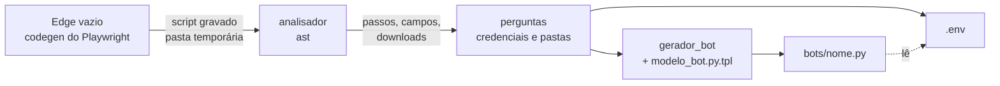

# Universal WebScrapping

Ensine uma tarefa no navegador uma vez e receba um bot em Python que a repete sozinho.

O programa abre um Microsoft Edge vazio. Você faz a tarefa como faria no dia a dia: login, escolher
um local, aplicar um filtro, baixar um CSV. Ao fechar o Edge, ele gera `bots/<nome>.py`, um script
independente que refaz tudo, salva o download na pasta escolhida e pode rodar agendado, sem janela.

```
$ python webscraper_universal.py
Nome do novo bot (ex.: cotacao_sp): cotacao_sp

Vou abrir o Microsoft Edge vazio para você ensinar a tarefa:
  1. Digite o endereço do site na barra e faça a tarefa normalmente.
  2. Se baixar arquivos, não precisa movê-los: no fim eu pergunto a pasta de destino.
  3. Quando terminar, FECHE a janela do Edge.

Campos digitados durante a gravação:
  [1] Usuário: joao.silva   <- parece credencial
  [2] Senha: (oculto, 8 caracteres)   <- parece credencial
  [3] Buscar produto: auto
Quais são credenciais (vão para o .env, fora do código)? [Enter = 1,2]:
Pasta de destino do download #1 ("Exportar CSV"): C:\Users\voce\Documents\Cotacoes

Bot pronto: ...\bots\cotacao_sp.py
  Rodar: python bots/cotacao_sp.py   (ou: python bots/cotacao_sp.py --headless)
  Credenciais guardadas no .env: COTACAO_SP_USUARIO, COTACAO_SP_SENHA

Ensinar um novo bot? [s/N]
```

## Como funciona



1. **Gravação**: `gravador.py` roda `python -m playwright codegen --channel msedge` e espera você fechar o Edge.
   O gravador do Playwright escolhe seletores estáveis (papel e nome acessível, rótulo, texto) e lida com
   iframes, pop-ups e downloads.
2. **Análise**: `analisador.py` lê o script gravado com `ast`, descarta a abertura/fechamento do navegador e
   separa os campos digitados e os downloads. O script bruto tem a senha em texto puro, então só existe numa
   pasta temporária apagada logo depois da leitura.
3. **Perguntas**: quais campos são credenciais (vão para o `.env`), para qual pasta vai cada download e, se
   a gravação abrir um endereço logo depois de uma ação, se foi você que o digitou (veja Decisões técnicas).
4. **Geração**: `gerador_bot.py` transforma os passos e preenche o modelo do bot.

## O bot gerado

Um arquivo único que depende só de `playwright` e `python-dotenv`:

- lê as credenciais do `.env` e confere se todas existem antes de abrir o navegador;
- registra cada passo em `logs/<nome>.log` e, se algo falhar, salva um print da tela em `logs/`;
- salva cada download na pasta escolhida, com o nome original do arquivo (substitui o anterior); um download
  que não apareceu na gravação vai para `downloads/<nome>/`, com um aviso no log;
- sai com `0` (sucesso), `1` (falha em algum passo) ou `2` (credencial ausente).

```
python bots/cotacao_sp.py              # com a janela do Edge
python bots/cotacao_sp.py --headless   # sem janela
```

No topo do arquivo dá para ajustar `TIMEOUT_MS`, `ESPERA_REDE_MS` e as pastas de destino.

## Como agendar

No **Agendador de Tarefas do Windows**: *Criar Tarefa Básica* → escolha o horário → *Iniciar um programa*:

| Campo | Valor |
|---|---|
| Programa/script | o `python.exe` que aparece no cabeçalho do bot |
| Adicionar argumentos | `"C:\caminho\do\projeto\bots\cotacao_sp.py" --headless` |
| Iniciar em | a pasta do projeto |

A coluna *Resultado da última execução* mostra o código de saída: `0x0` deu certo, `0x1` falhou (veja o log e
o print em `logs/`), `0x2` falta credencial no `.env`.

Antes de agendar:

- Com *Executar estando o usuário conectado ou não*, unidades mapeadas (`Z:\`) não existem. Use o caminho de
  rede (`\\servidor\pasta`) como destino dos downloads.
- O bot repete exatamente o que foi digitado na gravação, todo dia: uma data digitada num filtro continua a
  mesma. Para filtros que mudam, edite o passo no bot.
- Se a senha do sistema mudar, atualize o `.env` (ou ensine o bot de novo). Com a senha antiga o bot falha no
  login, e alguns sistemas bloqueiam a conta depois de algumas tentativas.

## Instalação

Requer Windows, Python (testado no 3.14) e o Microsoft Edge instalado.

```
pip install -r requirements.txt
python webscraper_universal.py
```

O Playwright usa o Edge já instalado (`channel="msedge"`); não precisa baixar navegador.

## Para testar sem um sistema real

O repositório traz um site de cotações fictício:

```
python tests/site_demo/servidor.py        # http://127.0.0.1:8000  (usuário demo, senha demo123)
```

Ensine um bot com ele: login, Local = SP, Filtrar, Exportar CSV (OK na confirmação), feche o Edge. O filtro
demora 1,5 s de propósito e o botão de exportar nunca fica desabilitado, como em muitos sistemas reais.

## Decisões técnicas

- **Esperar o filtro carregar.** `wait_for_load_state("networkidle")` só vale para navegação: num filtro feito
  por XHR ele retorna na hora. O bot conta as requisições em andamento (eventos `request`/`requestfinished`/
  `requestfailed`) e espera a rede ficar 500 ms parada depois de cada clique ou digitação (há buscas que filtram
  enquanto você digita) e antes de cada download, até `ESPERA_REDE_MS`. Se a janela da ação fechou sozinha (a
  "lupa" de escolher um item), continua esperando pelas outras. Se o limite estourar, só registra e segue. Um
  teste remove essa espera e mostra a base saindo errada.
- **Página que recarrega sozinha.** Depois de marcar uma caixa ou escolher numa lista, sistemas antigos
  (ASP.NET, JSF) recarregam a página, e o codegen grava isso como `page.goto(url)`. Repetir esse `goto` abre a
  página do zero e desfaz o filtro. Quando a gravação abre um endereço logo depois de uma ação, o programa
  pergunta se você o digitou; se não, o bot só espera a página recarregar.
- **Downloads em janela nova.** Quando o arquivo nasce numa janela que acabou de abrir, o codegen não o liga a
  nenhuma ação e a gravação fica sem o download. O bot vigia todas as janelas e salva esses arquivos em
  `downloads/<nome>/`.
- **Diálogos de confirmação.** O codegen sempre escreve `dialog.dismiss()`, porque não registra se você clicou
  OK. O bot gerado usa `dialog.accept()`; com `dismiss` a exportação do site demo nunca acontece.
- **Senhas no `.env`.** O `set_key` do python-dotenv só escapa aspas simples: uma senha terminada em `\` some
  junto com a linha seguinte e `\\` vira `\`. Cada valor é gravado na forma que o parser lê de volta idêntica,
  e a ida e volta é conferida. O bot carrega o `.env` com `interpolate=False` (um `$` na senha fica como está).
- **Vazamento de senha.** Se um valor marcado como credencial aparece em outro texto da gravação (por exemplo,
  numa URL), o bot não é gerado e o programa pergunta as credenciais de novo.
- **Ctrl+C durante a gravação.** `python -m playwright` só embrulha o node, que abre o Edge. Matar só o primeiro
  deixaria o navegador aberto sem dono; o gravador encerra a árvore inteira (`taskkill /T`).

## Segurança

- `.env`, `bots/`, `logs/` e `downloads/` estão no `.gitignore`. Os bots guardam endereços e nomes de campos
  dos sistemas automatizados, e os logs podem ter prints da tela.
- Senhas não aparecem no código gerado nem na tela (o terminal mostra só o tamanho). Nos logs, o bot troca o
  valor de toda credencial por `***`, inclusive nos erros do Playwright, que repetem o texto digitado.
- Só os campos marcados como credencial vão para o `.env`. Uma senha num campo com rótulo incomum (PIN, código
  de acesso) não é marcada sozinha: confira a lista antes de apertar Enter.

## Limitações

- Login com MFA/SSO e CAPTCHA não são reproduzidos.
- Não extrai dados da tela (tabelas): o bot repete ações e baixa arquivos.
- Upload de arquivo: o codegen grava só o nome do arquivo, não o caminho.
- Ações fora do navegador (mover arquivos no Explorer) não são gravadas; por isso o destino dos downloads é
  perguntado no fim.
- O analisador depende do formato do codegen; por isso o Playwright está fixo em 1.61.0.

## Testes

```
pytest -q
```

97 testes: unitários offline e oito de ponta a ponta que geram um bot a partir de uma gravação e o rodam no
Edge (headless) contra o site demo: filtro lento, busca enquanto digita, janela de escolha que se fecha sozinha,
download numa janela nova, confirmação antes de exportar e senha que não pode vazar no log quando um passo
falha. Os de ponta a ponta são pulados se o Edge não estiver instalado.

## Estrutura

```
webscraper_universal.py   ponto de entrada: o loop ensinar -> gerar -> ensinar outro
gravador.py               roda o codegen no Edge
analisador.py             lê a gravação (ast)
interface.py              perguntas no terminal e seletor de pasta
credenciais.py            nomes das variáveis e gravação no .env
gerador_bot.py            transforma os passos e preenche o modelo
modelo_bot.py.tpl         modelo do bot gerado
tests/                    testes, gravações de exemplo e o site demo
docs/superpowers/         spec e plano de implementação
```
