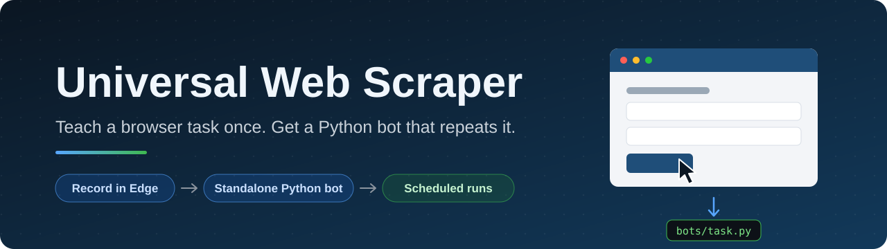
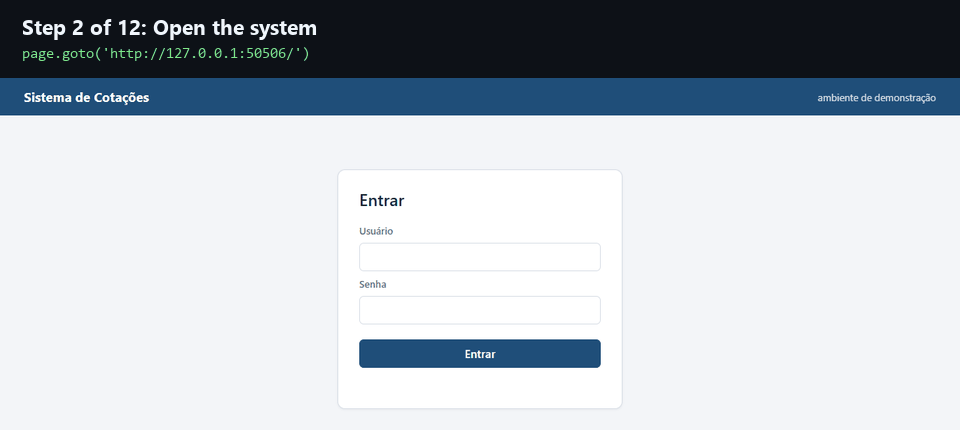
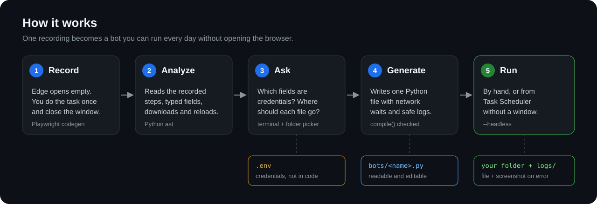
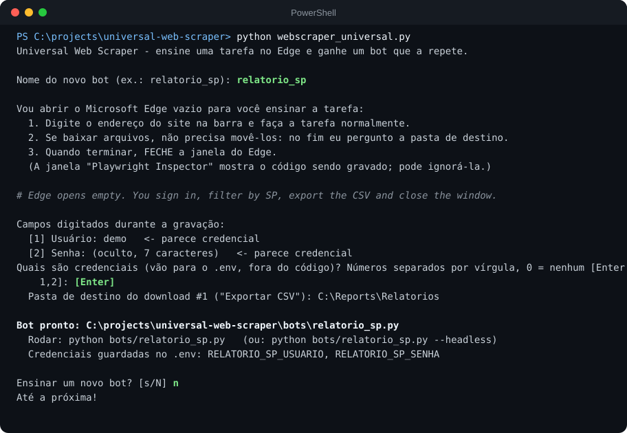
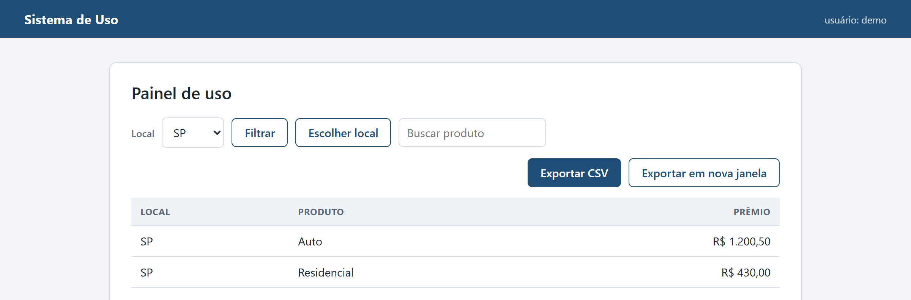

<p align="center">
  
</p>

<p align="center">
  <a href="https://github.com/MatPasquali/universal-web-scraper/actions/workflows/tests.yml"></a>
  
  
  
  <a href="LICENSE"></a>
</p>

<p align="center"><a href="README.md">English</a> · <b>Português (Brasil)</b></p>

O Universal Web Scraper transforma uma tarefa que você faz à mão num sistema web em um bot Python independente. Você abre uma janela vazia do Microsoft Edge, faz login, navega pelas telas, baixa o arquivo e fecha a janela. A ferramenta lê o que o Playwright gravou, pergunta quais valores digitados são credenciais e para onde vai cada download, e escreve `bots/<nome>.py`. Rode esse arquivo quando precisar dos dados, ou deixe o Agendador de Tarefas do Windows rodá-lo com `--headless`.

<p align="center">
  
</p>

## Por que existe

Muito trabalho de escritório é a mesma rotina: entrar num sistema interno, escolher um local, aplicar um filtro, esperar a tabela, exportar um CSV e mover o arquivo de Downloads para outra pasta. O gravador do Playwright já registra esses cliques com seletores baseados em papel, rótulo e texto visível. Mesmo assim, uma gravação crua é um bot ruim. Ela guarda a senha em texto puro, clica em Exportar antes de o filtro terminar de carregar, cancela a confirmação que você aceitou e não salva o arquivo baixado em lugar nenhum que você encontre. Este projeto cobre essas lacunas para que a gravação vire algo que dá para agendar.

## Como funciona

<p align="center">
  
</p>

1. `gravador.py` roda `python -m playwright codegen --channel msedge` e espera você fechar o navegador. O script bruto contém a sua senha, por isso só existe numa pasta temporária, apagada logo depois da leitura.
2. `analisador.py` lê o script com o módulo `ast` do Python. Descarta a abertura do navegador, junta cada valor digitado e cada download, e marca todo `page.goto()` que veio logo depois de uma ação na mesma página.
3. `interface.py` pergunta, no terminal, quais campos são credenciais, para qual pasta vai cada download e se foi você que digitou cada endereço marcado.
4. `gerador_bot.py` reescreve os passos e preenche o `modelo_bot.py.tpl`. O resultado precisa passar no `compile()` e não pode conter nenhum valor de credencial; caso contrário, nada é salvo.
5. Você roda `bots/<nome>.py`.

## Primeiros passos

Você precisa de Windows, Microsoft Edge e Python (testado no 3.14). O Playwright usa o Edge que já está instalado, então não há navegador para baixar.

```powershell
git clone https://github.com/MatPasquali/universal-web-scraper.git
cd universal-web-scraper
pip install -r requirements.txt
python webscraper_universal.py
```

A sessão no terminal é curta. Esta é ela inteira:

<p align="center">
  
</p>

## Teste no sistema demo

O repositório traz o Sistema de Uso, um pequeno sistema falso que os testes também usam. Ele tem login, um filtro que leva 1,5 segundo para carregar, um botão de exportar que nunca fica desabilitado, uma caixa de confirmação, uma busca que filtra enquanto você digita, uma janela de escolha que se fecha sozinha e uma exportação que abre numa janela nova.

```powershell
python tests/site_demo/servidor.py    # http://127.0.0.1:8000, usuário demo, senha demo123
```

Em outro terminal, rode `python webscraper_universal.py`. Na janela vazia do Edge abra `127.0.0.1:8000`, faça login, escolha SP, clique em Filtrar, clique em Exportar CSV, aceite a confirmação e feche a janela.

<p align="center">
  
</p>

## Como é um bot gerado

Cada bot é um arquivo único que depende só de `playwright` e `python-dotenv`. Estes são os passos do bot gerado na sessão acima, sem as linhas de log:

```python
def executar_passos(context: BrowserContext) -> None:
    page = context.new_page()
    page.goto('http://127.0.0.1:8000/')
    aguardar_rede(page)
    page.get_by_label('Usuário').click()
    aguardar_rede(page)
    page.get_by_label('Usuário').fill(credencial('RELATORIO_SP_USUARIO'))
    aguardar_rede(page)
    page.get_by_label('Senha').click()
    aguardar_rede(page)
    page.get_by_label('Senha').fill(credencial('RELATORIO_SP_SENHA'))
    aguardar_rede(page)
    page.get_by_role('button', name='Entrar').click()
    aguardar_rede(page)
    page.get_by_label('Local').select_option('SP')
    aguardar_rede(page)
    page.get_by_role('button', name='Filtrar').click()
    aguardar_rede(page)
    page.once('dialog', lambda dialog: dialog.accept())
    aguardar_rede(page)
    with page.expect_download() as download_info:
        page.get_by_role('button', name='Exportar CSV').click()
    download = download_info.value
    salvar_download(download, DESTINO_DOWNLOAD_1)
```

Em volta desses passos, o modelo lê as credenciais do `.env` e, se faltar alguma, para com código 2 antes de abrir o navegador. Registra cada passo em `logs/<nome>.log`, com os valores das credenciais trocados por `***`. Quando um passo falha, salva um print de cada página aberta em `logs/` e sai com código 1. Downloads que a gravação não pegou vão para `downloads/<nome>/`, com um aviso no log. `TIMEOUT_MS`, `ESPERA_REDE_MS` e as pastas de destino são constantes no topo do arquivo.

## Agendamento

No Agendador de Tarefas do Windows, escolha *Criar Tarefa Básica*, defina o horário e depois *Iniciar um programa*:

| Campo | Valor |
|---|---|
| Programa/script | o `python.exe` que aparece no cabeçalho do bot |
| Adicionar argumentos | `"C:\caminho\do\universal-web-scraper\bots\meu_bot.py" --headless` |
| Iniciar em | a pasta do projeto |

A coluna *Resultado da última execução* mostra o código de saída: `0x0` deu certo, `0x1` algum passo falhou (veja o log e o print em `logs/`), `0x2` falta credencial no `.env`.

Antes de agendar:

- Com *Executar estando o usuário conectado ou não*, unidades mapeadas como `Z:\` não existem. Use o caminho de rede (`\\servidor\pasta`) como destino dos downloads.
- O bot repete exatamente o que foi digitado na gravação. Uma data digitada num filtro continua a mesma todo dia; edite esse passo no bot se ela precisar mudar.
- Se a sua senha mudar, atualize o `.env` ou ensine o bot de novo. Com a senha antiga o bot falha no login, e alguns sistemas bloqueiam a conta depois de algumas tentativas.

## Decisões técnicas

Cada uma veio de um bug encontrado durante o desenvolvimento ou os testes, e cada uma tem um teste.

### Esperar dados que carregam em segundo plano

`wait_for_load_state("networkidle")` só vale para navegação, então depois de um filtro que busca dados por XHR ele retorna na hora. `aguardar_rede()` conta as requisições em andamento pelos eventos `request`, `requestfinished` e `requestfailed` do contexto e espera a rede ficar 500 ms parada, até `ESPERA_REDE_MS`. Ela roda depois de cada clique e de cada digitação, e antes de cada download. Se a página recebida fechar, como faz uma janela de escolha, a espera continua por outra janela aberta, e as requisições de janelas fechadas deixam de contar. Quando o limite estoura, registra uma linha no log e segue. Um teste remove essas esperas e confere que o CSV exportado sai errado.

### Caixas de confirmação

O gravador do Playwright escreve `dialog.dismiss()` para toda caixa de diálogo, porque o evento que ele registra não diz se você clicou em OK ou em Cancelar. O bot gerado chama `dialog.accept()`. Com `dismiss()` a exportação do demo nunca começa e o bot estoura o tempo esperando o download.

### Páginas que recarregam sozinhas

Tecnologias mais antigas, como ASP.NET WebForms e JSF, recarregam a página quando você marca uma caixa ou escolhe um item numa lista. O codegen grava esse recarregamento como `page.goto(url)`, e repetir isso abre a página do zero e perde o filtro. Quando a gravação navega logo depois de uma ação na mesma página, a ferramenta pergunta se você digitou aquele endereço. Se não digitou, o bot espera a página recarregar em vez de navegar.

### Downloads que começam numa janela nova

Quando o arquivo vem de uma janela que acabou de abrir, o codegen não liga o download a nenhuma ação e a gravação o perde. O bot escuta downloads em todas as páginas e salva os que a gravação não pegou.

### Credenciais e o `.env`

O `set_key` do python-dotenv 1.2.2 só escapa aspas simples, então um valor terminado em barra invertida corrompe a linha seguinte do arquivo e `\\` vira `\`. A versão 1.2.4 também escapa a barra. A ferramenta monta o valor entre aspas por conta própria e só pede ao `set_key` que grave, então o resultado é o mesmo nas duas versões; depois ela lê o arquivo de novo para conferir. Os bots carregam o `.env` com `interpolate=False`, então um `$` na senha continua sendo `$`.

### Senhas nos logs

Quando um `fill()` falha, a mensagem de erro do Playwright repete o texto que estava sendo digitado. O formatador de log do bot troca cada valor de credencial por `***`, do mais longo para o mais curto, porque um nome de usuário pode estar dentro de uma senha.

### Ctrl+C durante a gravação

`python -m playwright` só embrulha um processo Node.js, e é o Node que abre o Edge. Matar só o invólucro deixa o Node e o navegador abertos, então o gravador encerra a árvore inteira de processos com `taskkill /T`.

## Segurança

- `.env`, `bots/`, `logs/` e `downloads/` estão no `.gitignore`. Os bots guardam endereços internos e nomes de campos, e os logs podem ter prints de tela.
- Valores que você marca como credencial nunca aparecem no código gerado, nos logs ou na tela. Para uma senha, o terminal mostra só o tamanho.
- Só os campos marcados vão para o `.env`. Uma senha digitada num campo com rótulo incomum (um PIN, um código de acesso) não vem pré-selecionada, então leia a lista antes de apertar Enter.
- Se errar algo durante a gravação, feche o Edge e comece de novo. O gravador guarda cada tentativa, inclusive uma senha digitada errada, e o bot as repetiria.

## Limitações

- Logins com MFA ou SSO e CAPTCHAs não podem ser repetidos.
- O bot repete ações e baixa arquivos. Ele não extrai dados da página.
- Em uploads de arquivo, o codegen grava só o nome do arquivo, não o caminho.
- Roda apenas no Windows (Agendador de Tarefas, `taskkill`), e o Playwright está fixo na 1.61.0 porque o analisador depende do formato do código que o codegen escreve.

## Testes

```powershell
pytest -q
```

São 97 testes. 89 rodam offline. Os outros 8 geram um bot a partir de uma gravação e o rodam no Edge headless contra o sistema demo, cobrindo um filtro lento, uma busca que filtra enquanto você digita, uma janela que se fecha sozinha, um download numa janela nova, uma confirmação antes de exportar e uma senha que precisa ficar fora do log quando um passo falha. O GitHub Actions roda a suíte inteira no `windows-latest`. Os testes de ponta a ponta são pulados em máquinas sem o Edge.

## Estrutura do projeto

```text
webscraper_universal.py   ponto de entrada: ensinar, gerar, ensinar outro
gravador.py               roda o codegen no Edge
analisador.py             lê a gravação com ast
interface.py              perguntas no terminal e seletor de pasta
credenciais.py            nomes das variáveis e gravação no .env
gerador_bot.py            reescreve os passos e preenche o modelo
modelo_bot.py.tpl         modelo de todo bot gerado
tests/                    testes, gravações de exemplo e o sistema demo
docs/images/              imagens deste README
```

## Licença

MIT. Veja [LICENSE](LICENSE).
